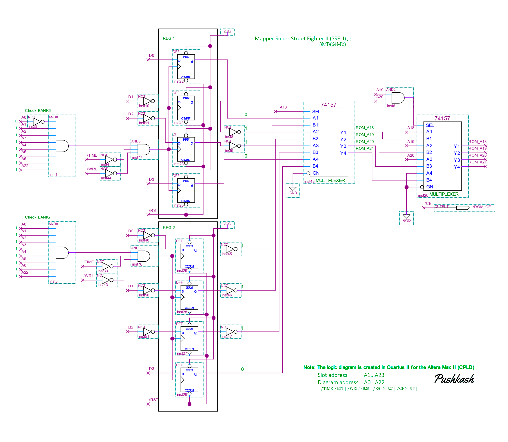
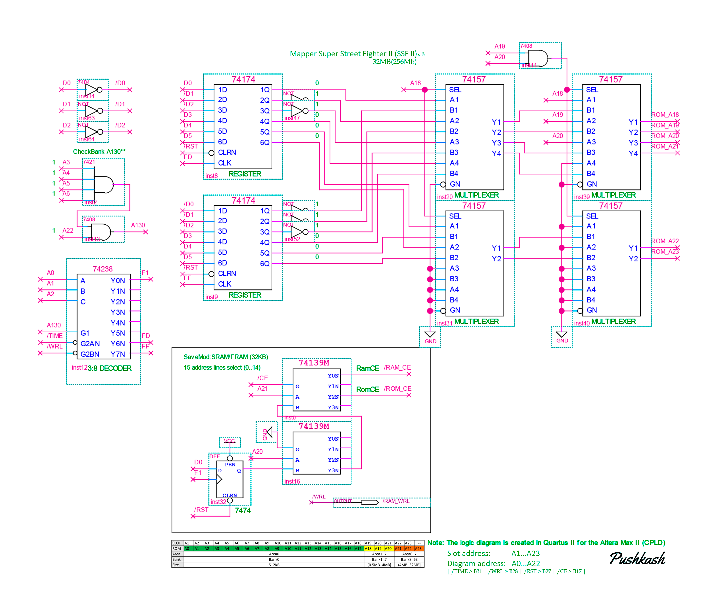
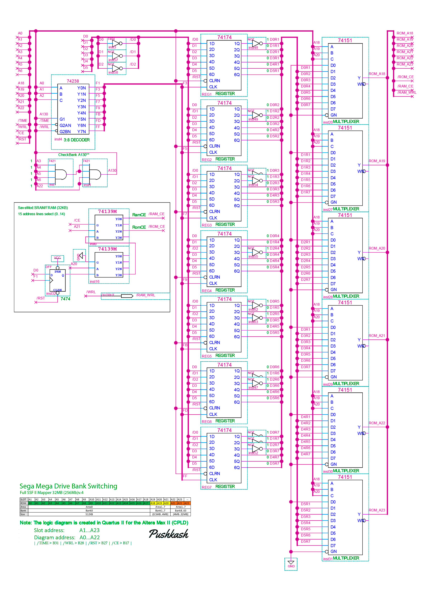

🌐 **Язык / Limba / Language:** [Русский](README.md) | [Română](README_RO.md) | [English](README_EN.md)

---

# 🕹️ Sega Mega Drive / Genesis Custom Mappers & Bank Switching

Custom mapper architecture and `Bank Switching` system for Sega Mega Drive / Genesis cartridges, presented in three consecutive versions and modifications (from a basic D-flip-flop scheme to a full SSF2 equivalent).

> **Author:** Pushkash  
> All schematics and architectural solutions were personally designed by the project author.

---

## 🔍 Addressing and Memory Management Features

* **Direct Addressing $A0 \to A1$:** In the schematics, memory chip addressing starts from line $A0$, whereas on the console cartridge slot, the address bus numbering starts from $A1$. Therefore, line $A0$ in the schematics connects to slot line $A1$.
* **Non-volatile Save Support (32 KB):** Versions v.3 and v.4 implement save support based on **32 KB ($256 \text{ Kbit}$) FRAM / SRAM** (standard battery power circuitry is required if a regular **SRAM** is installed).

---

## 🛠 Schematics & Architecture Analysis

### 📌 v.2 — Up to 8 MB (64 Mbit) Mapper on D-Flip-Flops

* **Component Base:** Built on D-flip-flops without a save block.
* **Operation Logic:**
  * **Banks 0–5:** Controlled directly by the Motorola 68000 processor.
  * **Startup Preset (Banks 6 and 7):** Implemented via inversion of individual data lines on the registers, which hardware-sets initial states: `REG:1 = 6` and `REG:2 = 7`, allowing the first 4 MB of ROM to be read immediately upon power-up.
  * **Address Switching:** Flip-flops define the upper address bits for accessing memory above 4 MB.

---

### 📌 v.3 — Up to 32 MB (256 Mbit) Mapper on **74xx174** / **74xx157** with FRAM / SRAM (32 KB)

* **Component Base:** **74xx174** registers, **74xx157** multiplexers, and **FRAM / SRAM (32 KB)** support.
* **Bank Switching Logic:**
  * **Banks 0–5:** Fixed to the Motorola 68000 processor.
  * **Startup Preset (Banks 6 and 7):** Implemented via inversion of individual data lines on registers, hardware-setting initial states: `REG(inst8) = 6` and `REG(inst9) = 7`, allowing the first 4 MB of ROM to be read immediately upon power-up.
  * **Addressing above 4 MB:**  
    * Controlled by lines $A{18}\dots A{20}$ and writes to `REG(inst8)` , `REG(inst9)` which output the required address on Flash memory lines `ROM_A18 ... ROM_A23`.

---

### 📌 v.4 — Full SSF2 Mapper up to 32 MB (256 Mbit) on **74xx174** / **74xx151** with FRAM / SRAM (32 KB)

* **Component Base:** 7 registers **74xx174**, 6 multiplexers **74xx151**, and **FRAM / SRAM (32 KB)** support.
  * **Bank 0:** Hardwired (interrupt vectors and program header).
  * **Hardware Startup Presets:** Implemented via inversion of individual data lines on registers, hardware-setting initial states: `Register 1 = 1`, `Register 2 = 2` ... `Register 7 = 7`, allowing the first 4 MB of ROM to be read immediately upon power-up.
  * **Addressing above 4 MB:**  
    * Controlled by lines $A{18}\dots A{20}$ and register writes $REG{1}\dots REG{7}$, outputting the required address on Flash memory lines `ROM_A18 ... ROM_A23`.

---

## 🖼 Schematic Files
* `SSF2_CARD_MAPP_v2.png` — v.2 Mapper scheme up to 8 MB on D-flip-flops.
* `SSF2_CARD_MAPP_v3.png` — v.3 Mapper scheme up to 32 MB on **74xx174** / **74xx157** with 32KB FRAM/SRAM.
* `SegaMegaDriveBankSwitching_v4.png` — v.4 SSF2 Mapper scheme (7 registers **74xx174** / 6 multiplexers **74xx151**) with 32KB FRAM/SRAM.